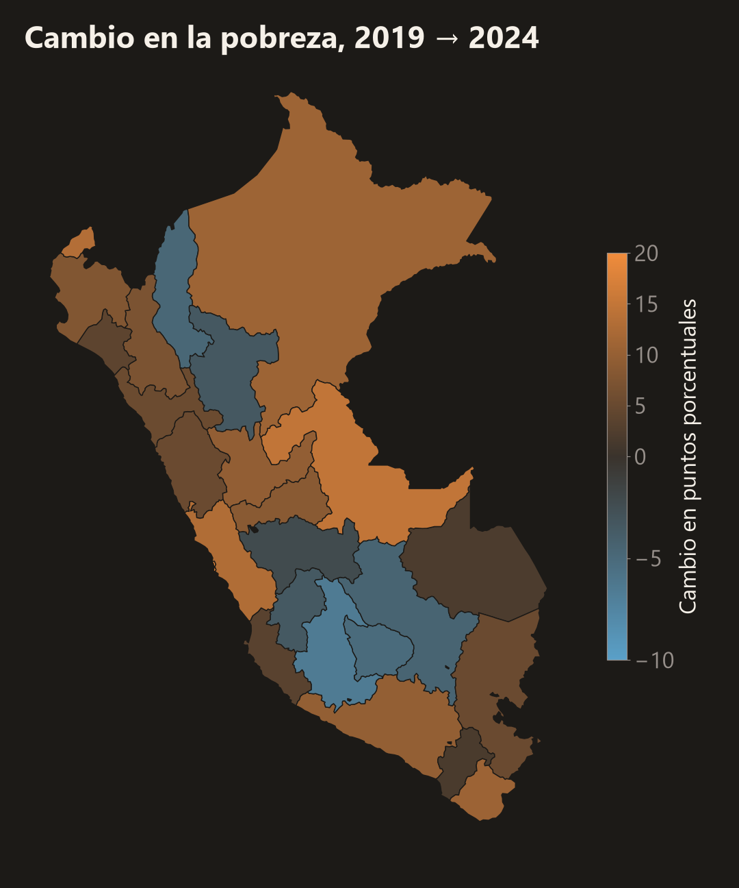

**Question:** How did monetary poverty change by department in Peru between 2019 and 2024?

**Result:** Poverty has not returned to its pre-pandemic level. It rose from 20.2% in 2019 to 30.1% in 2020 and was still 27.6% in 2024: 9.5 million people, 2.9 million more than in 2019. Poverty is clearly higher in 10 of 25 departments and clearly lower in none, and it became more urban: in Lima Metropolitana it doubled, from 14.2% to 28.2%.

The national figure matches INEI's official poverty rate in all six years, using 205,090 households from the ENAHO survey and 95% confidence intervals that respect the survey design.

## Interactive dashboard

<iframe src="https://jhane080.github.io/pobreza-peru-enaho/" title="Poverty in Peru dashboard" width="100%" height="650" style="border:1px solid #ddd; border-radius:6px;" loading="lazy"></iframe>

[Open the dashboard in a new tab](https://jhane080.github.io/pobreza-peru-enaho/) · [Code on GitHub](https://github.com/Jhane080/pobreza-peru-enaho) · [Reel (59 s)](https://github.com/Jhane080/pobreza-peru-enaho/blob/main/reel/reel.mp4)

**Tools:** Python, survey-weighted estimation, D3, GitHub Pages.
