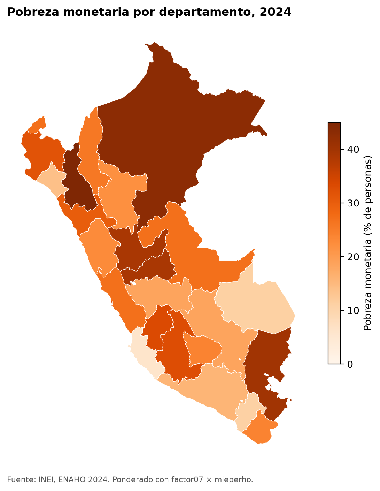

**Question:** Can an AI agent download, clean and map Peru's national household survey (ENAHO) and replicate the official poverty rate?

**Result:** Yes. The cleaned data gives 27.58% monetary poverty for 2024, against INEI's official 27.6%, with exactly the same 33,691 households and 108,664 usual residents. If the figure is more than 0.1 points away from the official one, the script stops and Claude does not use the data.

## How it works

Four skills, each one passing its output to the next:

| Skill | What it does |
|---|---|
| `descargando-enaho` | Downloads the survey modules from INEI's microdata portal |
| `limpiando-enaho` | Builds a household and a person dataset, and validates them against the official figure |
| `graficando-enaho` | Plots poverty by area, region, department, sex or age |
| `mapeando-enaho` | Draws a choropleth map of poverty by department |

You clone the repository, ask Claude for "a map of poverty by department", and get the map with the official figure replicated.

[Code on GitHub](https://github.com/Jhane080/skills-enaho)

**Tools:** Claude Code, Python, pandas, geopandas, uv.
