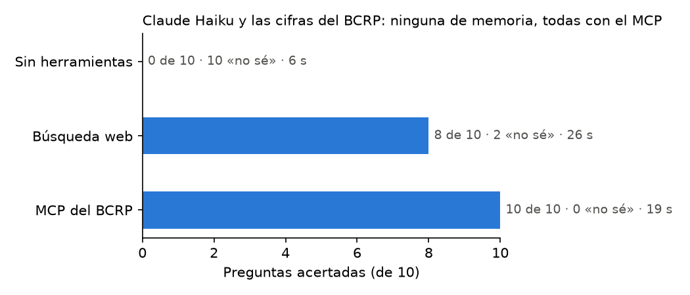

**Question:** How many official figures from Peru's Central Reserve Bank (BCRP) does Claude get right from memory, from web search, and with an MCP server built for it?

**Result:** With the MCP server, Claude answered 10 of 10 questions correctly; with web search, 8 of 10; from memory, 0 of 10. From memory it always said "I don't know" and never made up a number. The questions covered inflation, the policy rate, the exchange rate, reserves, copper prices, GDP, exports and unemployment.

## How it works

A server built with FastMCP searches the 17,167 BCRP series, downloads them and computes changes, always returning the source link. It connects to Claude Code, and an evaluation script asks Claude each question in every mode and grades the answers against the official figure.

[Code on GitHub](https://github.com/Jhane080/mcp-bcrp) · [Full report](https://github.com/Jhane080/mcp-bcrp/blob/main/informe.md)

**Tools:** Python, FastMCP, Claude Code, pytest.
